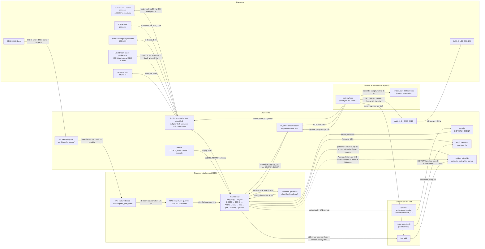

# enkakumon — Design Document

CS370 term project · Gideon Rank & Navin Mani · rev 1, Oct 28, 2026

Sources: [PROBLEM MEMO.md](PROBLEM%20MEMO.md) (requirements), [enkakumon v1 code plan.md](enkakumon%20v1%20code%20plan.md) (implementation contract), [CLAUDE.md](CLAUDE.md) (team rules), and the code in `src/`.

**Status key:** **Built** = in the repo now (Steps 1–2). **Step 3** = specified in the code plan, not yet written (`src/analysis/pet.c`). **Planned** = proposed here, beyond the v1 code plan (the history store that completes Mechanism D).

---

## 1. Architecture

Two processes, three threads, one shared I2C bus. `enkakumond` (C) owns every environmental sensor and the health system; `enkakumon-ui` (Python) owns the screen and touch and holds no graded logic. They talk only over a local Unix socket. systemd supervises the daemon.

**Threads.** `enkakumond` has exactly two: the main thread (everything time-critical except audio) and the mic capture thread (`src/mic.c`), which blocks in `snd_pcm_readi` so the 1 s loop never waits on audio. The only shared state is the RMS ring, guarded by one mutex held for a few dozen instructions; the stop and failure flags are C11 atomics. `enkakumon-ui` is single-threaded.

**Why the main loop is one thread.** Every non-audio event (timer tick, signal, socket accept, client input) arrives as an fd in one `poll()` call, so there is no locking in the sensor or IPC code, and the 1 s absolute `timerfd` keeps the SGP40 fed at the exact 1 Hz the Sensirion algorithm requires. Per-cycle work is budgeted at < 100 ms; the loop logs any overrun.

**Shared bus.** Both processes use `/dev/i2c-1`. Each `I2C_RDWR` ioctl is atomic under the kernel's adapter lock, and the daemon and UI talk to disjoint addresses, so they cannot corrupt each other's transactions. A slow UI transaction can delay a daemon read by at most a few ms.

---

## 2. Mechanism mapping

The problem memo chose **Mechanism D (custom storage layer)** and **Mechanism E (multi-process architecture)**. The memo's requirements, cited below as R1–R5:

- **R1** "consistently and concurrently monitor the inputs from multiple different sensors" (§5)
- **R2** "store and convey past stored information"; "determine patterns over time" (§3, §5)
- **R3** "highly portable, always-on" (§3)
- **R4** "the most major risk … is whatever happens when a battery dies" (§6)
- **R5** interactive digital pet whose state reflects the environment (Pitch, §1)

### Mechanism E — multi-process architecture

| Sub-mechanism | Component | Status | Justification |
| --- | --- | --- | --- |
| Process split: sensing/health in C, display/touch in Python | `enkakumond` (`src/main.c`) and `enkakumon-ui` (`src/ui/main.py`) | Built | R1: a full LCD redraw takes ≈ 0.2 s and Python GC pauses are unbounded; in a separate process neither can delay a sensor cycle or the SGP40's 1 Hz cadence. A UI crash leaves monitoring and the pet running (R3). |
| IPC: Unix stream socket, one JSON line per second out, `tap` lines in | `src/ipc.c`; `DaemonClient` in `src/ui/main.py` | Built | R1, R5: decouples producer and consumer rates. Non-blocking sends and drop-on-slow mean a stuck client can never stall the daemon. The text format can be read with `socat` for testing. |
| Dedicated capture thread for audio | `src/mic.c` (`capture()`), mutex-guarded RMS ring | Built | R1: 48 kHz audio must be drained continuously or ALSA overruns, which a 1 Hz loop cannot do. The thread keeps a 1 s window that the main thread samples without blocking. |
| Single-threaded event loop on `timerfd` + `signalfd` | `run()` in `src/main.c` | Built | R1: one wake source per event, absolute 1 s schedule with no drift, and signals handled as ordinary events so shutdown is never interrupted mid-write (R4). |
| Supervision: systemd unit, exit codes, heartbeat | `enkakumon.service`; heartbeat in `src/main.c`; `make soakcheck` | Built | R3: an always-on device must restart itself. Exit 1 (bad config) is not restarted; exit 2 and crashes are. The heartbeat makes "alive but wedged" detectable, which a running PID cannot show. |
| Per-device fault isolation | `dev_fail` / `dev_ready` in `src/sensors.c`; `mic_poll` in `src/mic.c` | Built | R1: one missing or flaky sensor (e.g. the absent SCD40) reports `null` and is retried every `RETRY_S`; every other sensor keeps reporting. |

### Mechanism D — custom storage layer

| Sub-mechanism | Component | Status | Justification |
| --- | --- | --- | --- |
| Crash-consistent pet state: `key=value` file, temp → `fsync` → `rename` (+ directory `fsync`) | `pet_save` / `pet_load` in `src/analysis/pet.c` | Step 3 | R4, R5: the pet must survive power loss. `rename` is atomic, so after a cut the file holds either the old state or the new one, never a mix. Saving every 60 s caps the loss at 60 s. |
| Clean-shutdown marker: `clean_exit=0` in periodic saves, `=1` in the SIGTERM save | `pet.c` | Planned | R4: on the next start the daemon can tell a clean stop from a power cut or crash and log it. This is how the battery-death case gets detected. |
| Minute-history ring file: fixed 64 B records with sequence number and CRC-32 | `src/history.c` (new); `HISTORY_PATH` in `enkakumon.conf` | Planned | R2: the memo's core use case ("patterns over time") needs more than the UI's 10-minute RAM buffer. Fixed-size records in a preallocated file give constant disk use, constant-time append, and torn-write detection by CRC. Full layout in §4. |
| History query over IPC: `history <minutes>` → stream of records | `src/ipc.c`, new "Trends" screen in `src/ui/` | Planned | R2 "convey": the UI shows days-long trends without reading the file itself, so the file format stays private to the C core (CLAUDE.md: no graded mechanism in Python). |
| In-RAM display history: 600-sample deque per metric, outage recorded as gaps | `src/ui/main.py` | Built | R2 (short term): 10-minute graphs at 1 Hz. Not part of the graded mechanism. |

---

## 3. Failure-mode table

Log lines are quoted as the code emits them (`journalctl -u enkakumon` for the daemon; the UI's stderr for `enkakumon-ui`). "Log once" means a fault logs one line when it starts and one `recovered` line when it ends, so a fault that persists does not flood the journal.

| Component | Failure | Detection | System response | Log shows |
| --- | --- | --- | --- | --- |
| **SCD40** (absent in this build) | Not on bus / NACK | `I2C_RDWR` ioctl fails during init | `co2`, `temp_c`, `rh` = `null`; SGP40 uses `DEFAULT_TEMP_C`/`DEFAULT_RH`; retry every 30 s | `enkakumond: scd40: init failed: No such device or address (retrying every 30 s)`. In this build this line is expected once at every start. |
| SCD40 | CRC mismatch on a data word | CRC-8 check (poly 0x31) | Value discarded, device marked down, periodic mode restarted on retry | `enkakumond: scd40: read failed: Bad message (retrying every 30 s)` |
| **SGP40** | NACK / CRC error | ioctl error / CRC-8 check | `voc` = `null`; retry every 30 s. Gas-index state stays in RAM and is reused on recovery | `enkakumond: sgp40: measure failed: …` or `read failed: Bad message`, then `sgp40: recovered` |
| SGP40 | Algorithm warm-up | Algorithm returns 0 for the first 45 s | Published as `null`; UI shows "warming up" for 60 s after connecting | none (expected) |
| SGP40 | Missed 1 Hz tick (cycle overrun) | `timerfd` expiry count > 1 | Runs one cycle with no catch-up; index accuracy drops slightly | `enkakumond: missed N timer ticks` |
| **APDS9960** | Absent / wrong ID / NACK | ID register ≠ 0xAB/0xA8 (`ENODEV`); ioctl error | `light`, `proximity` = `null`; sleep rule cannot fire; retry every 30 s | `enkakumond: apds9960: init failed: No such device (retrying every 30 s)` |
| **LSM6DSOX** | Absent / wrong WHO_AM_I / reset timeout | WHO_AM_I ≠ 0x6C; SW_RESET bit stuck (`ETIMEDOUT`) | `motion`, `steps` = `null`; on re-init the step counter restarts at 0 | `enkakumond: lsm6dsox: init failed: Connection timed out (retrying every 30 s)` |
| LSM6DSOX | Step counter reset or wrap | Step 3: new count < previous count | Pet treats it as a reset: a negative delta counts as 0 new steps, never a large negative | none (expected after re-init) |
| **I2C bus** | `/dev/i2c-1` missing (overlay off, permissions) | `open()` fails | All I2C readings `null`; daemon keeps running, mic and IPC unaffected; retry every 30 s | `enkakumond: i2c: open /dev/i2c-1 failed: Permission denied (retrying every 30 s)` |
| I2C bus | Bus hung (a device holds SDA low) | Every device fails in the same cycle | All four devices `null` and retried. v1 has **no bus-recovery clock pulse**, so only a power cycle fixes it | One `… failed: Remote I/O error` or `Connection timed out` line per device |
| **Mic / ALSA** | Card not found (overlay, `MIC_NAME`) | `snd_card_next` scan finds no matching name | `db` = `null`; retry every 30 s | `enkakumond: mic: no ALSA card matching 'googlevoicehat' (retrying every 30 s)` |
| Mic capture thread | xrun / suspend | `snd_pcm_readi`/`snd_pcm_wait` < 0 | `snd_pcm_recover` and restart inside the thread; no visible gap unless it lasts > 2 s | none if recovered |
| Mic capture thread | Unrecoverable error / thread exits | `failed` atomic set; samples > 2 s old | Main thread joins the thread and closes the PCM, `db` = `null`, reopens after 30 s | `enkakumond: mic: capture failed: <ALSA error> (retrying every 30 s)`, then `mic: recovered` |
| **Main loop** | Cycle > 100 ms | `CLOCK_MONOTONIC` delta per cycle | Continues; next tick is still on the absolute schedule | `enkakumond: cycle took N ms (budget 100 ms)` |
| Main loop | Wedged (deadlock, stuck ioctl) | Heartbeat mtime stops advancing | v1: `make soakcheck` fails at > 5 s stale. Planned: systemd `WatchdogSec=` with `sd_notify`-style ping replacing the bare file | soakcheck: `FAIL: heartbeat N s old at T s` |
| **Heartbeat** | `/dev/shm` not writable | `open`/`futimens` fails | At startup: exit 2. Later: keep running and log once | `enkakumond: heartbeat /dev/shm/enkakumon.heartbeat: …`; later `enkakumond: heartbeat: …` |
| **Config** | Missing file, bad line, bad value | `conf_load` parse | Exit 1; systemd does **not** restart (`RestartPreventExitStatus=1`) | `enkakumond: conf: enkakumon.conf:12: bad value for RETRY_S: 'x'`; systemd: `status=1/FAILURE` |
| **IPC listen socket** | Path held by a live daemon, or not a socket | Probe `connect()` succeeds / `lstat` not `S_ISSOCK` | Exit 2 (resource unusable); systemd retries until its start-rate limit | `enkakumond: ipc: another daemon is serving /tmp/enkakumon.sock` |
| IPC listen socket | Stale socket file from a crash | Probe `connect()` refused | File unlinked, socket re-bound; normal start | none |
| IPC client | Slow or broken reader | `send(MSG_DONTWAIT)` short or error; `POLLHUP`/`POLLERR` | Client dropped immediately; daemon never waits | **none in v1** (silent drop). Planned: log once per client with its slot number |
| IPC client | More than `MAX_CLIENTS` | No free slot at `accept` | Connection closed | `enkakumond: ipc: client limit (4) reached, refusing`; UI: `daemon closed the connection before sending data (MAX_CLIENTS reached?)` |
| **Daemon process** | Crash / `kill -9` / OOM kill | systemd sees abnormal exit | Restart after 2 s. Lost: ≤ 60 s of pet changes, ≤ 1 history record, step count (restarts at 0), and VOC baseline (algorithm relearns, 45 s blackout) | journal: `Main process exited, code=killed, status=9/KILL` then `Scheduled restart job`; Planned: `enkakumond: previous run ended uncleanly` |
| Daemon process | Clean stop | `signalfd` read | Stop SCD40, save pet, close fds, unlink socket, exit 0 | `enkakumond: Terminated, stopping` |
| **UI process** | Daemon unreachable | `connect()` fails / EOF | "daemon offline" screen; reconnect every 2 s; outage drawn as a gap | `enkakumon-ui: daemon disconnected`, later `connected to /tmp/enkakumon.sock` |
| UI process | Malformed JSON line | `json.loads` fails | Line ignored | `enkakumon-ui: ignored N malformed line(s)` (1st, then every 100th) |
| UI process | Touch controller missing | Blinka `OSError`/`ValueError` | Taps disabled, graphs still update; retry every 30 s | `enkakumon-ui: touch: … (retrying every 30 s)`, then `touch: recovered` |
| UI process | Display init fails / UI crash | Exception at init; process exits | Exit 2. **No supervisor in v1**: the screen stays dark while the daemon keeps working. Planned: `enkakumon-ui.service` | `enkakumon-ui: display init failed: …` |
| **Pet state** (Step 3) | Missing or corrupt `pet.state` | Open fails / parse fails / value out of range | Defaults (health 80, mood ok); next save overwrites it | `enkakumond: pet: <path>: <reason>, using defaults` |
| Pet state | Save fails (disk full, read-only FS) | `write`/`fsync`/`rename` error | Keep running with in-RAM state; temp file removed; retry at next 60 s save | `enkakumond: pet: save failed: No space left on device` (log once) |
| **History store** (Planned) | Torn record after power cut | CRC-32 mismatch on scan at startup | Record skipped, appends resume after the highest valid sequence number | `enkakumond: history: 1 torn record at slot N (power loss?)` |
| History store | File missing, wrong size, or bad header | `open`/`fstat`/magic check | Recreate and preallocate it; older history is lost | `enkakumond: history: <path>: <reason>, starting new file` |
| **Power** (USB now, battery later) | Supply cut / battery dies | Not detectable in v1; on next boot the `clean_exit=0` marker shows it | Recover from disk: pet ≤ 60 s old, history ≤ 1 record lost. Battery build: a low-battery GPIO triggers `systemctl poweroff`, so the shutdown is clean | Next boot: `enkakumond: previous run ended uncleanly`. `journalctl --list-boots` shows a boot with no `stopping` line |
| **microSD / ext4** | FS corruption or wear | fsck at boot; write `EIO` | Pet and history fall back as above; the daemon never treats storage as fatal | `pet: save failed: Input/output error` / `history: … Input/output error` |

---

## 4. Storage and data

| Data | Where | Rate | Format | Retention | Power dies mid-write |
| --- | --- | --- | --- | --- | --- |
| Live readings | Daemon RAM (`struct readings`) | 10 values at 1 Hz | C doubles, NaN = missing | One cycle | Lost; nothing to recover |
| Published stream | Unix socket → clients | ≈ 190 B/s per client | One JSON line, `null` for missing | None (not stored) | Lost; UI draws a gap |
| Mic window | Daemon RAM, mutex ring | 10 entries/s | `double` mean-square + timestamp | 1 s | Lost |
| UI graph history | UI RAM, `deque(maxlen=600)` × 10 | 1 sample/metric/s | Python floats / `None` | 10 min; cleared when the UI restarts | Lost |
| Heartbeat | `/dev/shm/enkakumon.heartbeat` (tmpfs) | mtime touched 1 Hz, 0 bytes | Empty file | Until reboot | Gone with RAM; recreated on start |
| Pet state (Step 3) | `PET_PATH`, default `~/enkakumon/pet.state` (ext4) | ≈ 150 B every 60 s + on clean exit | Text `key=value`: `health`, `mood`, `asleep`, `t`, `clean_exit` | Single file, overwritten | Write to `pet.state.tmp`, `fsync`, `rename` over `pet.state`, `fsync` the directory. A cut before the rename leaves the old file plus an orphan `.tmp` (ignored, then overwritten). A cut after leaves the new file. The file is never half old, half new. Worst case loses 60 s of health changes |
| Minute history (Planned) | `HISTORY_PATH`, default `~/enkakumon/history.bin` (ext4) | 1 × 64 B record/min = 92 KB/day | Binary, little-endian, preallocated ring (layout below) | 30 days = 43 200 slots = 2.76 MB fixed; oldest overwritten | `pwrite` of 64 B to a slot that never crosses a 512 B sector, then `fdatasync`. A cut leaves the slot old, new, or torn. A torn slot fails its CRC, is logged and skipped, and appends resume after the highest valid `seq`. Worst case loses one record plus the minute being averaged in RAM |
| Logs | journald (stderr of both processes) | Event-driven, log-once: ≈ 0 lines/s steady state, a few lines per fault | journald binary journal | Capped with a drop-in `SystemMaxUse=16M` (Planned) | journald syncs every 5 min (immediately for CRIT), so up to the last 5 min of log lines can be lost. This is why unclean shutdown is detected from `pet.state`, not from logs |
| Config | `enkakumon.conf` | Read once at start | `KEY = value` text | Hand-edited | Read-only at runtime; not at risk |

**History record layout (Planned, 64 B).** Each record holds one minute's averages over the valid samples.

| Offset | Field | Type |
| --- | --- | --- |
| 0 | magic `"EKH1"` | u32 |
| 4 | `seq` (monotonic, survives restarts) | u32 |
| 8 | `t` (unix seconds, start of minute) | i64 |
| 16 | `co2, temp_c, rh, voc, light, proximity, motion, db` means | 8 × f32 (NaN = no samples) |
| 48 | `steps` taken this minute | u16 |
| 50 | `health` 0–100, `mood` enum, valid-sample count (0–60) | 3 × u8 |
| 53 | reserved (zero) | 7 B |
| 60 | CRC-32 over bytes 0–59 | u32 |

Records are ordered by `seq`, not `t`: the Pi has no RTC, so after an offline power cut the wall clock can jump back to the last `fake-hwclock` save. Startup scans the whole file (2.76 MB, < 1 s on the Pi) after the heartbeat is first touched, so the 2 s heartbeat deadline still holds. One sync per minute is ≈ 1 440 small writes a day, well within microSD wear limits.

---

## 5. Constraints and substitutions

| Area | Ideal build | Actual build | What the gap costs |
| --- | --- | --- | --- |
| **CO₂ / temperature / humidity** | SCD40 (photoacoustic CO₂ plus T/RH), as the code plan specifies | **Not present.** The daemon code for it is written and unit-tested against datasheet conversion and CRC vectors, but has never run against the part | `co2`, `temp_c`, `rh` are always `null`. The CO₂ screen always shows "sensor offline". **Claims narrowed:** no CO₂, ventilation, or thermal-comfort claims. Health rules for CO₂ and T/RH never fire on the device, so only VOC and noise can lower health, and the "clean air" bonus is judged on VOC alone. Those rules are verified only by `test/test_pet.c` with **synthetic** readings (e.g. a 0 → 1600 ppm ramp); the daemon never fabricates CO₂ at runtime. |
| VOC compensation | SGP40 compensated with live T/RH from the SCD40 | Fixed fallback `DEFAULT_TEMP_C = 25`, `DEFAULT_RH = 50` | The VOC index drifts when real humidity is far from 50 %. **Claim narrowed:** VOC is a relative "worse than this room's usual" index, not an absolute concentration. |
| **Power** | LiPo battery, charger/boost, and fuel gauge with a low-battery GPIO that triggers a clean shutdown | USB 5 V supply. Battery to be added later; no power monitoring | **No portability or battery-life claims** yet (memo R3). Every power loss is an unplanned cut, the memo's R4 "battery dies" case, so correctness rests on the crash-consistent storage in §4. The evaluation simulates battery death by pulling the plug. |
| Sound level | Calibrated measurement mic or a Class 2 meter for reference | SPH0645 with `DB_OFFSET = 120` (datasheet-derived, uncalibrated) | Until `DB_OFFSET` is calibrated against a reference, `db` is **relative loudness**. After a one-point calibration the target is ±3 dB over 50–85 dB, with no A-weighting. |
| Light | Calibrated lux sensor | APDS9960 raw clear-channel count | Only relative brightness and "dark" detection for sleep, no lux. |
| UV, pressure | UV index sensor and BME680 (memo "nice to have" / required list) | Not in the build or the code plan | The memo's sunscreen-timing example cannot be delivered; no UV or pressure claims. |
| Timekeeping | RTC module | `fake-hwclock`; no network time (product makes no network calls) | Timestamps can jump after offline power cuts. History is ordered by `seq`, and absolute times are labelled approximate. |
| Storage medium | Industrial / power-loss-protected SD, or FRAM for state | Consumer microSD | Higher corruption and wear risk at the FS and controller level, which the app-level CRC and atomic rename only partly cover. |
| UI supervision | `enkakumon-ui.service` | UI started by hand | A UI crash leaves the screen dark until someone restarts it, although sensing continues. |
| Enclosure | Ventilated case isolating sensors from Pi heat | Bare boards (case not yet printed) | Proximity and light readings depend on how the boards are placed. T/RH self-heating would matter once the SCD40 is present. |

---

## 6. Evaluation plan

All measurements are taken on the Pi from the daemon's JSON stream (`socat - UNIX-CONNECT:/tmp/enkakumon.sock > run.jsonl`) unless noted. "Deferred" rows cannot be run without the absent SCD40 or the battery.

### Sensor measurements

| Measurement | Method | Target |
| --- | --- | --- |
| Sample cadence | Record 1 h of JSON; diff the `t` values; count `missed … ticks` lines in the journal | 3 600 ± 1 lines; every gap 1 s; 0 missed ticks |
| Cycle time | Count `cycle took` lines over the 48 h soak | 0 lines (every cycle < 100 ms) |
| VOC warm-up | Start the daemon; time to the first non-null `voc` | `null` for 45 ± 2 s, then 1–500 |
| VOC baseline and response | Room at rest for 1 h, then an open hand-sanitizer bottle 10 cm away for 30 s | Baseline 80–120; rises above 150 within 60 s; returns within 20 % of baseline within 30 min |
| Light | Three conditions: covered, room light, phone flashlight at 10 cm; 30 s each | Strictly increasing medians across the three; covered < 5 % of room-light value |
| Proximity | Flat card at 20, 10, 5, 2, 0 cm; 10 s each | Monotonic increase; ≤ 20 with nothing within 20 cm; > 200 when covered (sleep threshold) |
| Motion noise floor | Board still on a table for 5 min | 95th percentile `motion` < 0.1 m/s² |
| Motion response | Shake by hand for 10 s | Peak > 2 m/s²; per-minute average > 0.5 (pet activity rule) |
| Step count | Walk 100 counted steps with the device in hand, 3 trials | Each trial 90–110 new steps |
| Sound level | Phone SPL meter beside the mic: quiet room, speech, and a speaker playing pink noise at ≈ 70 and ≈ 85 dB. Set `DB_OFFSET` from the 70 dB point | After calibration, within ±3 dB at the other points; quiet room 30–45 dB; clap peak > 70 |
| Mic staleness | Stop capture (unload overlay or unplug mic) | `db` becomes `null` within 2 s; one `mic:` log line |
| CO₂ response | **Deferred (SCD40 absent)**: outdoor air 5 min, then breath | Outdoors 420 ± 50 ppm; breath raises > 1000 ppm within 30 s |
| Temp / RH | **Deferred (SCD40 absent)**: compare with a reference hygrometer for 1 h, tune `TEMP_OFFSET_C` | ±1 °C, ±5 % RH after offset |

### System measurements

| Measurement | Method | Target |
| --- | --- | --- |
| Fault isolation | Unplug the I2C cable for 60 s during `--print`, then reconnect | Process stays up; I2C values `--`/`null` within 1 s; one log line per device; `recovered` within `RETRY_S` + 1 s (≤ 31 s) of reconnect; `db` unaffected |
| Long-run stability | `make soakcheck` (1 h), then the 48 h soak with the same checks | RSS does not grow after warm-up; fd count constant; heartbeat never > 5 s stale; SIGTERM exits 0 |
| CPU | `pidstat -p <pid> 60` over 1 h for daemon and UI | Daemon < 5 % of one core; UI < 30 % |
| UI latency | Video at 60 fps: finger contact to screen change, 20 taps | Every tap < 1 s; median < 300 ms |
| Crash recovery | `kill -9` the daemon 10 times at random points | systemd restarts within 3 s each time; UI back from "daemon offline" within 2 s of the restart; health differs from the pre-kill value by at most 60 s of rule changes |
| Power-loss durability | Pull USB power 20 times at random moments (simulated battery death), including during a forced save loop (`PET_SAVE_S = 1` test config) | 20/20 boots: `pet.state` parses (old or new, never corrupt); history has ≤ 1 torn record, which is skipped; `previous run ended uncleanly` is logged |
| Battery runtime | **Deferred (no battery)**: full charge to auto-shutdown under normal UI use | Clean shutdown logged before power is lost; runtime recorded (target set once the cell is chosen) |

---

## 7. Ownership map

| Component | Owner |
| --- | --- |
| Code implementation | Navin |
| Hardware / code cleanup | Gideon |

---

## 8. AI-use plan

Use of AI is permitted for code and documentation, but not for any art that will appear on the screen of the device in a later state. Submission and logging of transcripts is an essential part of proper AI usage. Creation of comprehensive documentation in order to guide agents' approach is also a must.
